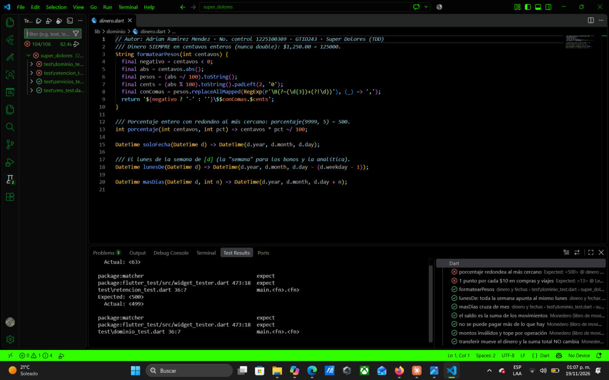
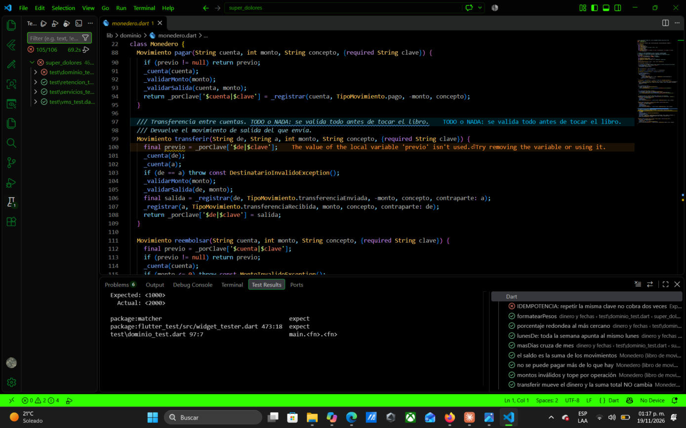
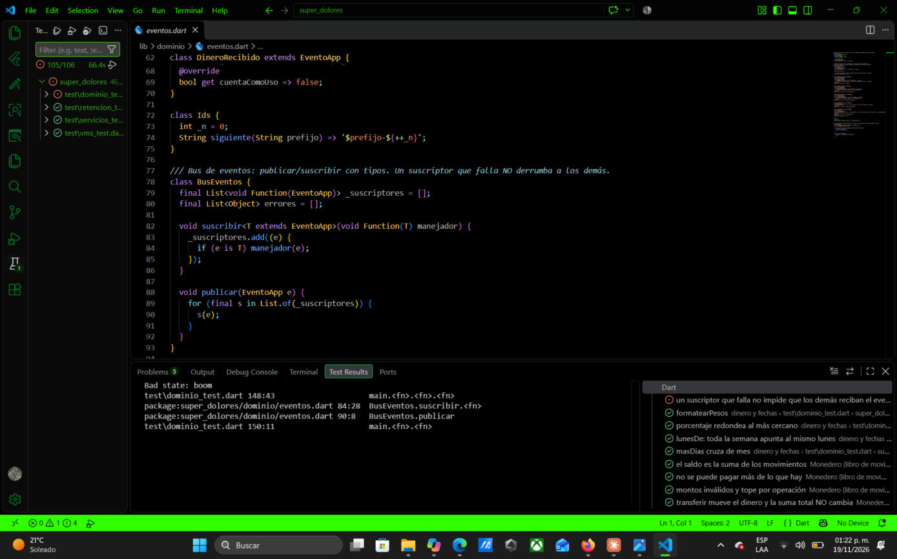
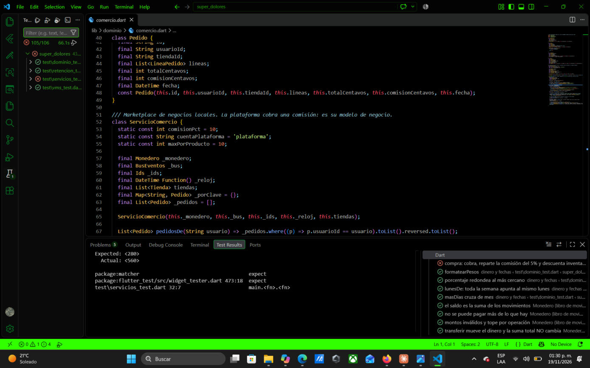
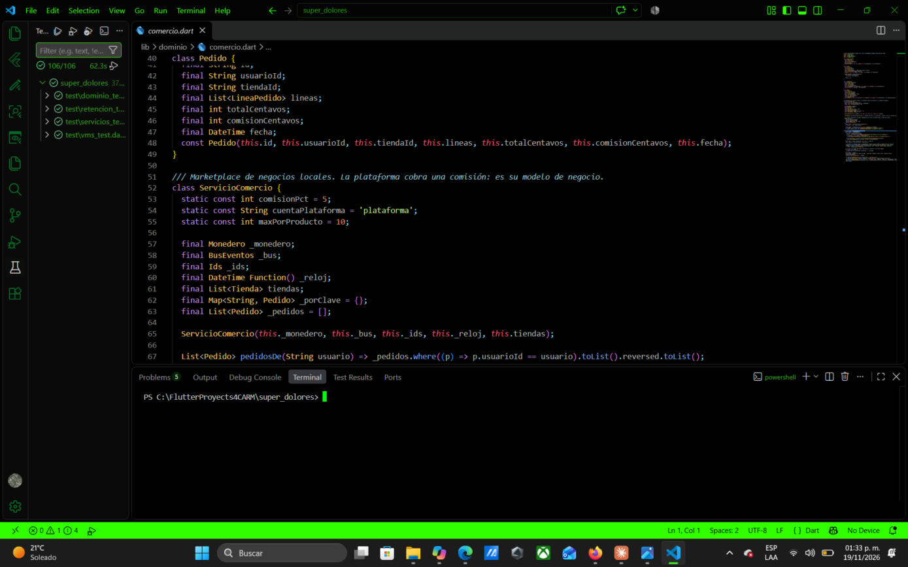
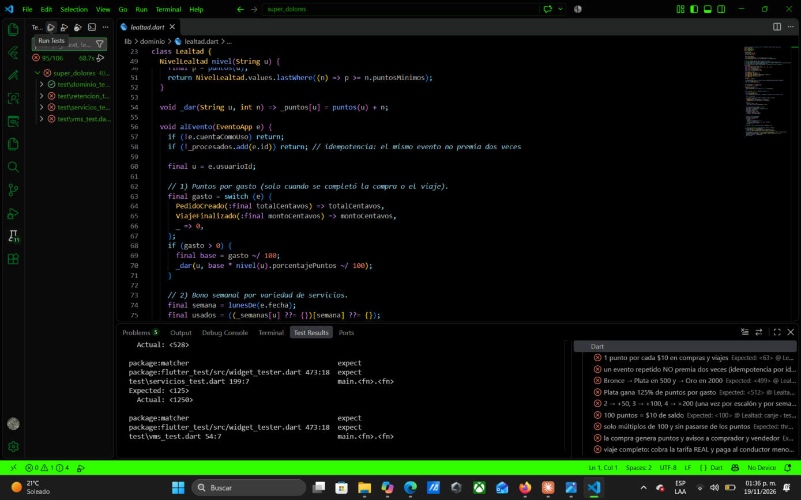

# 🛒 Super Dolores — Super app con TDD

Super app de Dolores Hidalgo (monedero, comercio, transporte, mensajería, lealtad, analítica y notificaciones) hecha en Flutter/Dart con **TDD**.

- **Materia:** Desarrollo Móvil Integral · UTNG
- **Profesor:** Anastacio Rodríguez García
- **Alumno:** Adrian Ramirez Mendez · No. de control 1225100309 · Grupo GTID243

Cada archivo `.dart` empieza con la línea de autor, y en las capturas se ve la ruta `C:\FlutterProyects4CARM\super_dolores`.

## Ciclo TDD
🔴 **ROJO:** se mete el código malo y la prueba falla → 🟢 **VERDE:** se pone el código bueno y pasan las **106 pruebas**.

## 📸 Evidencias por ronda

### Ronda 1 · Sin código
🔴 Las pruebas existen pero el código aún no, así que no compila.


### Ronda 2 · Dinero (porcentaje redondeado)
🔴 `centavos * pct ~/ 100` trunca en lugar de redondear.

🟢 `(centavos * pct + 50) ~/ 100` redondea al más cercano.


### Ronda 3 · Monedero (idempotencia)
🔴 Sin `if (previo != null) return previo;` la misma transferencia se cobra dos veces.

🟢 Con la clave de idempotencia se cobra una sola vez.


### Ronda 4 · Bus de eventos (aislar fallos)
🔴 Sin `try/catch`, un suscriptor que falla tumba a los demás.

🟢 Con `try/catch` el error se registra y los demás reciben el evento.


### Ronda 6 · Comercio (comisión)
🔴 `comisionPct = 10`: la prueba espera 280 y sale 560.

🟢 `comisionPct = 5`.


### Ronda 9 · Lealtad (puntos por gasto)
🔴 `gasto ~/ 100` da 1 punto por peso: fallan 11 pruebas.

🟢 `gasto ~/ centavosPorPunto` da 1 punto por cada $10.


## Corrección al manual
En `test/retencion_test.dart` el manual esperaba 13 puntos, pero olvidaba su propia regla del bono semanal (2 servicios distintos = +50). Se corrigió a `5 + 8 + 50`.

## ▶️ Cómo ejecutarlo
```bash
flutter pub get
flutter test
```
