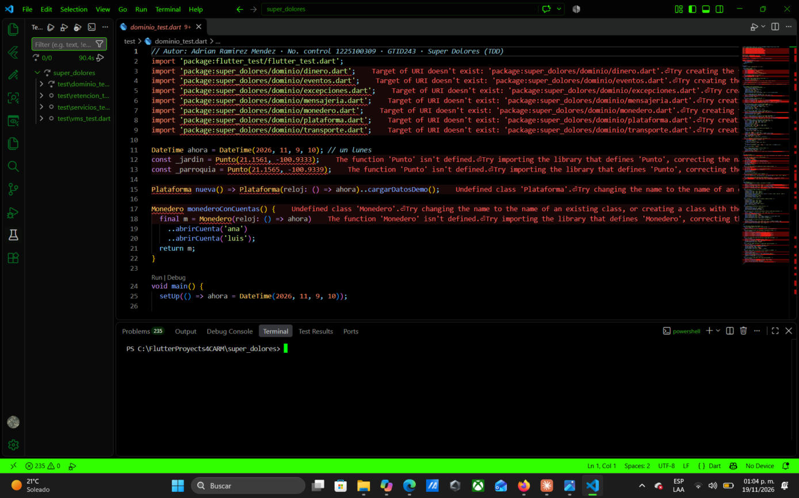
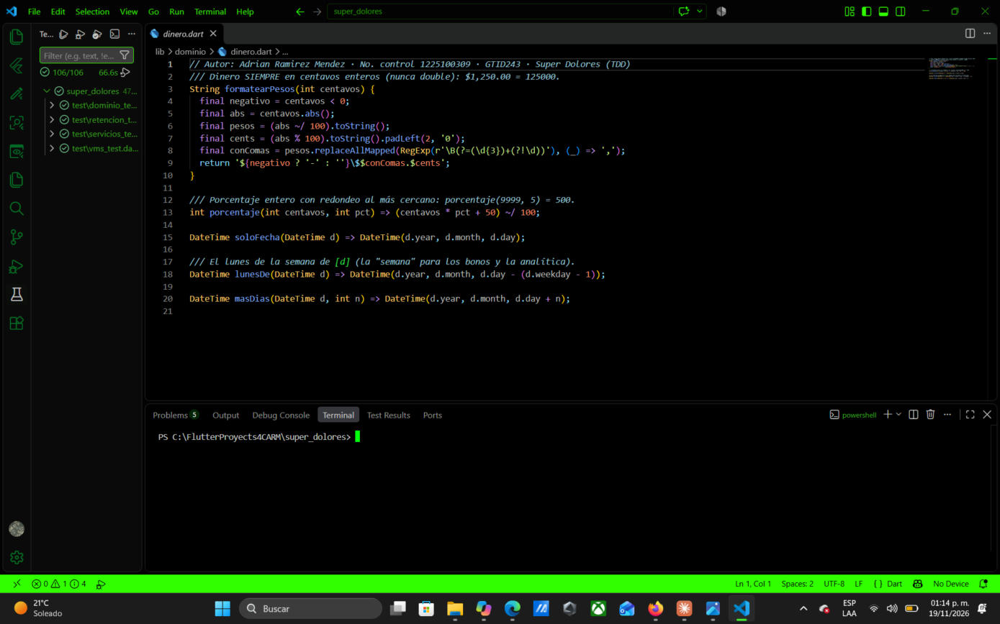
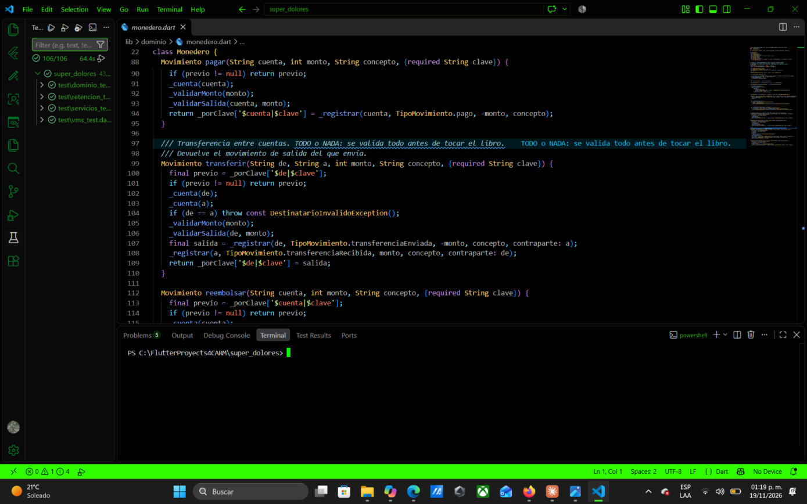
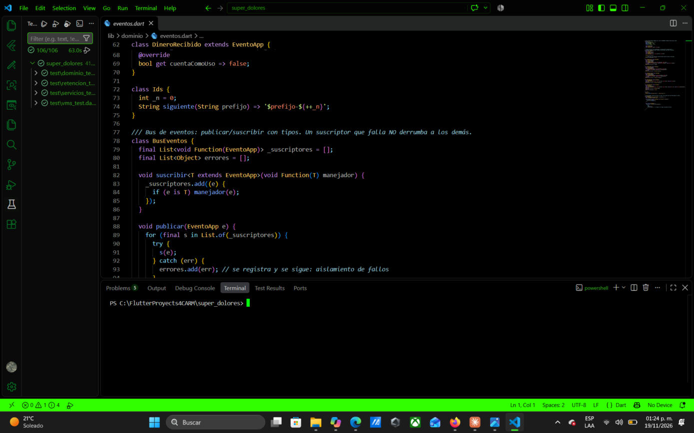
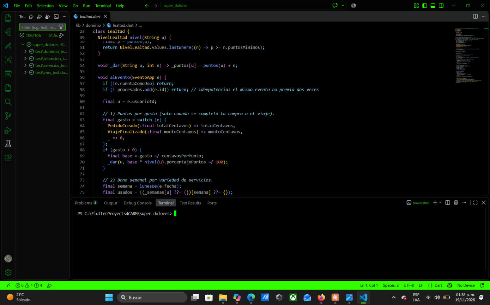

# 🛒 Super Dolores — Super app con TDD

Super app de Dolores Hidalgo (monedero, comercio, transporte, mensajería, lealtad, analítica y notificaciones) hecha en Flutter/Dart con **TDD**.


###  · Sin código
 Las pruebas existen pero el código aún no, así que no compila.


###  · Dinero (porcentaje redondeado)
 `centavos * pct ~/ 100` trunca en lugar de redondear.

`(centavos * pct + 50) ~/ 100` redondea al más cercano.


###  · Monedero (idempotencia)
Sin `if (previo != null) return previo;` la misma transferencia se cobra dos veces.

 Con la clave de idempotencia se cobra una sola vez.


###  · Bus de eventos (aislar fallos)
Sin `try/catch`, un suscriptor que falla tumba a los demás.

Con `try/catch` el error se registra y los demás reciben el evento.


###  · Comercio (comisión)
 `comisionPct = 10`: la prueba espera 280 y sale 560.

 `comisionPct = 5`.


### · Lealtad (puntos por gasto)
 `gasto ~/ 100` da 1 punto por peso: fallan 11 pruebas.

 `gasto ~/ centavosPorPunto` da 1 punto por cada $10.



## Corrección al manual
En `test/retencion_test.dart` el manual esperaba 13 puntos, pero olvidaba su propia regla del bono semanal (2 servicios distintos = +50). Se corrigió a `5 + 8 + 50`.

## ▶️ Cómo ejecutarlo
```bash
flutter pub get
flutter test
```
